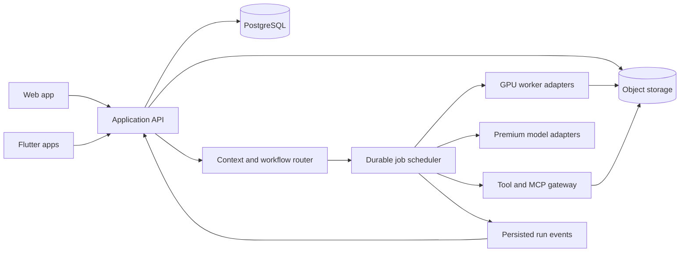

# 2. Architecture and contracts

Date: September 30, 2026. Status: proposed defaults for discussion and implementation. [Planning index](../../README.md).

## Web and Flutter decision

**Proposed default: React + TypeScript web application, Flutter for iOS/Android, one backend and shared API contracts.** Use Vite for the application shell; public marketing pages can be selected separately. This proposal favors browser editor/media integration while preserving a native mobile path.

| Option | Benefit | Tradeoff | Decision trigger |
|---|---|---|---|
| React web + Flutter mobile | Browser-native editing/media ecosystem; native mobile UX | Two UI implementations | Recommended if rich web workspaces lead |
| Flutter web + Flutter mobile | More shared UI and Dart code | Validate rich text, browser accessibility, media/3D bridges early | Choose if one UI codebase is the overriding priority |

Flutter documents its web target as appropriate for application experiences; document-like public pages have different needs. Neither choice removes platform-specific testing. [Flutter web guidance](https://docs.flutter.dev/platform-integration/web/faq)

Shared means schemas, design tokens, workflow identifiers, state semantics, and generated TypeScript/Dart clients. React components are not reusable Flutter widgets. Generate clients from OpenAPI; keep business rules on the server. Build a mobile slice early enough to catch web-only assumptions. iOS builds and signing require macOS/Xcode; plan a Mac or macOS CI runner alongside this Windows development environment. [Flutter iOS deployment](https://docs.flutter.dev/deployment/ios)

## Service layout

Start with a modular Python/FastAPI backend, PostgreSQL, object storage, and separately deployed workers. Keep routing, workflow execution, and tools as modules with explicit interfaces; they do not need independent microservices immediately. Use a PostgreSQL job table with transactional claims/leases for the PoC. A later queue or durable workflow engine can implement the same contract.

Put long-running generation outside web request handlers. Containers for image, video, TRELLIS.2, and Blender are separate because their native dependencies and resource needs differ. A single GPU host may run these sequentially during development; that is not three independently warm services.

## Routing sequence

1. Resolve authenticated user, project, permitted sources, quality tier, and budget.
2. Honor an explicit capability choice; otherwise classify the request.
3. Produce a schema-validated intent: capability, required input types, missing inputs, desired output, complexity, quality, and proposed workspace.
4. Select an approved workflow version. Ambiguous requests get a targeted clarification; unsupported requests receive an honest response.
5. Bind workflow stages to eligible models, tools, and worker pools using memory profiles, current availability, estimated cost, and policy.
6. Persist the plan and reserve the run's budget before dispatch.
7. Execute stages, save artifacts, emit events, and reconcile actual usage.

The classifier proposes a route; server rules determine entitlement, costs, tool authority, and valid execution targets. Begin with explicit capability buttons and deterministic routing. Evaluate a small model for natural-language classification once the three workflows run. A client-installed classifier is optional and its results remain untrusted hints.

Capability identifiers: `chat`, `text_to_image`, `image_to_video`, `image_to_3d`. Composition can later introduce `text_to_3d` without introducing a new GPU model. Prefer a complete model stage on one worker for the initial three capabilities.

## Domain records

All user-owned records include account ownership; all access checks resolve that ownership on the server.

| Record | Minimum contents |
|---|---|
| Project | Name, instructions, default context mode, archive state |
| Chat / Message | Project, role, structured text and attachment parts, timestamps |
| ContextGrant | Source, destination, scope, snapshot/live type, revocation |
| ContextSnapshot | Sources and versions actually selected for a run |
| Artifact / ArtifactVersion | Storage key, MIME type, size/hash, lineage, previews, producing stage |
| WorkflowDefinition | Immutable version, input/output schemas, stages, dependencies, retry and budget rules |
| SkillDefinition | Versioned instructions, examples, constraints, evaluations, referenced tools |
| ModelManifest | Exact model revision, license records, runtime digest, memory profiles, supported settings |
| Run / StageAttempt | Workflow version, state, inputs, route, lease, attempt, outputs, errors |
| UsageEntry | Estimated/reserved/actual cost, GPU time or provider units, deduplication key |
| ConnectorBinding | Tool capabilities, account credential reference, permitted actions |

An agent is a bounded configuration of model, instructions, tools, and budget. A skill is reusable guidance. A workflow is an executable dependency graph. An MCP connection exposes tools. Keep these concepts separate so a prompt document is not mistaken for an executable job specification.

## API outline

Use a versioned `/v1` API. The following are proposed contracts, not implemented endpoints.

| Endpoint | Responsibility |
|---|---|
| `/projects`, `/projects/{id}` | Create/list/update/archive projects |
| `/chats`, `/chats/{id}` | Create/list/update/move/archive chats |
| `/chats/{id}/messages` | Persist a user message; return its ID |
| `/context-grants` | Create/list/revoke explicit sharing |
| `/uploads`, `/uploads/{id}/complete` | Authorize direct object upload and validate completion |
| `/runs` | Submit from a message ID with idempotency key and budget |
| `/runs/{id}`, `/runs/{id}/events` | Read state and stream resumable events |
| `/runs/{id}/cancel`, `/runs/{id}/retry` | Cancel or explicitly create a linked retry |
| `/artifacts/{id}`, `/artifacts/{id}/download` | Read metadata and issue authorized download URL |
| `/capabilities`, `/workflows`, `/models` | User-visible enabled catalog and constraints |
| `/usage` | Estimated and actual consumption |

Persisting a message does not also submit inference; clients call `/runs` once using the returned message ID. This prevents ambiguity about duplicate generation.

Large attachments travel directly to object storage using short-lived authorized URLs, rather than base64 inside chat payloads. The API checks ownership, size, type, and readiness before a run references an upload. Tooling sees artifact references scoped to its stage.

Use server-sent events or an equivalent streaming client with a monotonically increasing event cursor. Provide polling and event replay for mobile reconnection. Events include `run_id`, `sequence`, `stage_id`, `type`, `timestamp`, and a typed payload. Ordinary chat also emits incremental text events through this interface.

## Job correctness

States: `queued -> preparing -> running -> postprocessing -> succeeded`, plus `cancel_requested`, `cancelled`, and `failed`. Stage attempts have their own state. Workflow stages can wait for dependencies or user selection.

- Workers claim jobs with expiring leases and heartbeat while active.
- Use at-least-once delivery with idempotent transitions and output registration; do not claim exactly-once GPU execution.
- Reconcile provider request IDs before retrying uncertain external API submissions.
- Bound retries by stage policy, deadline, and remaining budget. Keep succeeded stages and resume only failed dependencies where valid.
- Cancellation stops future stages and requests interruption of active work. Already consumed compute remains in usage records.
- A GPU out-of-memory failure may retry on a larger approved target within the budget; otherwise show options. Never silently replace the workflow with a paid API outside policy.
- Persist job state before broadcasting events. Browser refresh or app suspension must not own the job lifecycle.

## Provider and tool interfaces

Compute adapters expose `capabilities`, `estimate`, `submit`, `status`, `cancel`, and result/usage retrieval. Deployment adapters manage worker hosts separately from model execution. This allows AWS, GCP, specialist clouds, and eventual personal workers to serve the same run contract.

Premium adapters translate common messages and tool requests into each provider's supported format. Capability flags cover image input, structured output, tool use, and streaming; do not assume identical semantics. Use configurable, evaluated model IDs, not a hard-coded promise that an alias is always the best model.

- OpenAI: use the Responses API for a new integration. [Official OpenAI documentation](https://developers.openai.com/api/docs/guides/migrate-to-responses)
- Anthropic: integrate the Messages API and its model catalog. [Claude API overview](https://platform.claude.com/docs/en/api/overview)
- Grok: integrate through the documented xAI API adapter. [Grok API documentation](https://docs.x.ai/overview)

API accounts, usage billing, and customer tiers are managed by Powwow. The PoC can meter usage without implementing checkout. Unconfigured providers appear unavailable; live-provider parity is a separate milestone.

For tools, build a small central gateway with an allowlist, typed inputs, credential references, deadlines, and audit events. Start with managed artifact operations and a bounded Blender worker tool. Desktop-only integrations later use a local connector agent. User input must not select arbitrary host commands or install arbitrary MCP servers.

## Extension surfaces

Define a workspace registry with capability IDs, accepted artifact types, supported actions, and client renderer IDs. The server chooses a known workspace type; clients render bundled trusted UI. Adding a writer workspace later should add structured writing records and a renderer without replacing project/chat infrastructure.

Keep future worker ownership and placement attributes in the provider model. Public peer enrollment and payment logic are not implemented in this PoC. Standard authentication, tenant separation, and secret handling remain normal application requirements while the earlier peer-privacy research is deferred.
