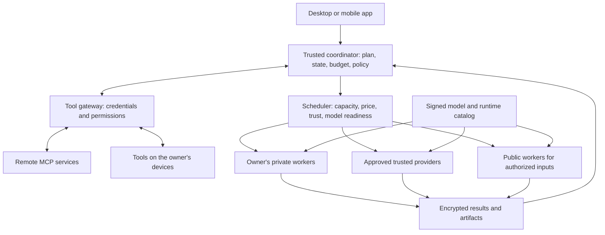

# Powwow: feasibility and proposed design

> **Current direction, September 30, 2026:** Start with a web app, Flutter mobile clients, and Powwow-managed rented GPUs. See the [current PoC planning index](../README.md). That plan supersedes this document's initial rollout sequence; this document remains background research.

Research date: September 27, 2026. This is a design proposal, not a tested implementation. Hardware inventory below was read locally; prices and platform capabilities were checked against linked primary sources. Numerical scenarios are explicitly illustrative.

Follow-up: [Private peer inference and local model capability](powwow-privacy-and-capability-options.md) examines confidential hardware, MPC, FHE, trusted-controller outsourcing, and the RTX 5090/frontier-model comparison. Private public-pool inference requires one of the specified protection mechanisms; ordinary encrypted transport is insufficient against the worker owner.

## 1. Recommendation

Build Powwow first as a personal AI workspace that can use the owner's devices remotely. Extend the same job protocol to invited providers, then to a paid public pool.

The core product is feasible. It needs an orchestration layer, a managed model catalog, secure workers, and useful task workflows. It does not require inventing a new inference engine. Public marketplace confidentiality, result verification, mobile background availability, and unit economics are the difficult additional problems.

Recommended initial promises:

- Use your own hardware from any of your devices.
- Connect your tools once and make them available through a controlled gateway.
- Download and manage the models needed for supported tasks automatically.
- Choose private execution, trusted providers, or explicitly authorized public processing.
- Show the expected cost, wait, and quality tier before an expensive job.

Treat universal lowest price, universal model support, and guaranteed private execution on strangers' consumer GPUs as unproven claims. A thin request classifier can select capabilities; the surrounding system must still handle state, permissions, placement, retries, billing, and quality.

### A concrete first device

Read-only inspection of the current Windows machine found:

- NVIDIA GeForce RTX 5080 **Laptop** GPU, 16,303 MiB reported VRAM.
- Approximately 31.4 GiB system RAM.
- Intel Core Ultra 9 275HX.

This is a reasonable candidate for compact quantized language models and selected image workflows. Video and 3D eligibility must be measured for each workflow and settings. No inference benchmark, power measurement, upload test, model installation, or runtime installation has been performed. Desktop GPU results must not be substituted for this laptop's performance.

## 2. What a remote GPU actually needs

A model is a computation graph plus numerical parameters, called weights. The host CPU runs the serving software, prepares input, schedules work, and manages memory. A discrete GPU executes kernels using accessible data, normally with active weights in VRAM. Apple silicon and some other devices use shared memory, changing placement details but not the need to access those weights.

A worker needs:

1. Compatible drivers and an inference runtime.
2. The weights or model components assigned to it.
3. Tokenizers, configuration, and any required encoders/decoders/adapters.
4. Request inputs and temporary working memory.
5. For language generation, space for attention state, often called the KV cache.

**Every device does not need every model.** Powwow can install runtimes once, automatically fetch selected models, and keep a bounded cache. A shard worker needs its assigned layers rather than the whole model. Weights may be held in RAM or streamed from storage, but repeatedly moving them into GPU memory sacrifices speed. [Diffusers memory and offloading guide](https://huggingface.co/docs/diffusers/optimization/memory)

Your proposed remote-GPU intermediary has an existing analogue: llama.cpp RPC lets a controller use remote compute devices and cache large tensors on them. This moves model management out of the user's way; it does not make weights unnecessary. The maintainers explicitly describe this RPC backend as fragile and insecure for open networks. Study it inside a trusted cluster; do not expose it directly as a public worker protocol. [llama.cpp RPC](https://github.com/ggml-org/llama.cpp/blob/master/tools/rpc/README.md)

### Why model caching matters

Weights-only storage is approximately `parameter count × bits per parameter / 8`. Quantization metadata and execution memory are additional.

| Illustrative model | Raw weights at 4 bits | Ideal download at 100 Mbps | Ideal download at 1 Gbps |
|---|---:|---:|---:|
| 8 billion parameters | 4 GB | 5 min 20 sec | 32 sec |
| 70 billion parameters | 35 GB | 46 min 40 sec | 4 min 40 sec |

These use decimal GB and ideal sustained links. Actual transfers take longer. Sending a model with every small request would dominate cost and latency; sending a prompt to an already loaded worker is a much smaller operation.

Dense language models ordinarily use their layers repeatedly during generation. A short prompt does not identify a tiny downloadable part of the model. Mixture-of-experts models activate fewer experts per token, but the required experts vary; fetching them across home internet connections is another scheduling and latency problem.

### Model management at large scale

Use an immutable manifest for every supported execution recipe:

- Model source, revision, license, redistribution permissions, and artifact hashes.
- Runtime build, supported operating systems/backends, quantization, and configuration.
- Weights, tokenizer, encoders, decoders, adapters, and required workflow assets.
- Tested memory envelopes by context length, batch, image size, frames, and precision.
- Quality evaluation results and compatible input/output schemas.

Workers maintain disk quotas, resumable downloads, a cache inventory, a small set of pinned popular models, and eviction rules. Distinguish downloaded, loaded in memory, and actively serving states. Only the latter two reduce cold-start latency substantially.

Distribute permitted model artifacts through verified origins or mirrors; later add peer seeding of public weights with signed manifests and hash checks. Deduplicate identical components. An existing reference for chunk-level artifact deduplication is [Hugging Face Xet](https://huggingface.co/docs/hub/xet/index). Download counts alone do not establish permission to redistribute a model.

One base model plus compatible LoRA adapters can cover several specialties without duplicating every base weight. Adapters still need the base and task-specific evaluation. [PEFT LoRA guide](https://huggingface.co/docs/peft/main/conceptual_guides/lora)

## 3. How to combine devices

| Work division | Feasibility | Proposed place in Powwow |
|---|---|---|
| Independent prompts, images, seeds, documents, renders | Straightforward when each worker fits its task | Initial implementation |
| One user request broken into research, generation, conversion, and validation jobs | Practical; dependencies limit concurrency | Initial implementation |
| Separate pipeline components such as encoding, denoising, decoding | Useful when transfers are small enough | Experiment after a whole-worker baseline |
| Different layers of one model on different devices | Technically demonstrated; latency and recovery are harder | Trusted local clusters, then specialized experiments |
| Matrix/tensor or context parallelism across distant home GPUs | Frequent communication often defeats the benefit | Outside the initial product |

Splitting layers usually expands the model size that fits; it does not imply that one response becomes faster. Pipeline throughput with several simultaneous requests and single-request latency are different metrics.

Petals demonstrates internet-spanning layer inference. Its 2023 controlled test of quantized Llama 2 70B on three T4s achieved 1.44 tokens/second at 2,048-token sequence length with 100 Mbps bandwidth and 100 ms RTT. This is historical evidence of feasibility, not a prediction for this machine or current models. The paper also discusses leakage through intermediate activations. [Petals paper, Table 2 and limitations](https://arxiv.org/html/2312.08361v1)

Current serving guidance emphasizes fast interconnects for fine-grained distributed execution. [vLLM parallelism guide](https://github.com/vllm-project/vllm/blob/main/docs/serving/parallelism_scaling.md), [Diffusers distributed inference](https://huggingface.co/docs/diffusers/main/training/distributed_inference)

### Modality-specific decisions

- **Chat and coding:** Prefer a warm worker and keep a session there while it is healthy. Moving its state or rebuilding context adds work.
- **Images:** Distribute independent generations. Keep the repeated denoising loop together initially.
- **Video:** Distribute independent clips. Individual frames inside a temporally coupled generation cannot generally be treated as unrelated image jobs.
- **3D:** Route generation stages as complete jobs; separately distribute candidate assets, texture work, conversions, and renders.
- **Spritesheets:** Use a workflow for shared character conditioning, pose control, background removal, alignment, and atlas packing. Parallel image generation alone does not ensure visual consistency.

Useful experimental division: text encoder on one device, denoiser on another, decoder on a third. Each stores its component and only stage-boundary artifacts cross the network. Compare this with local offloading; the network can still be the slower option.

Treat several tightly connected machines in one home or studio as one provider. That provider can use local parallelism while Powwow schedules a single complete job to it. [exo](https://github.com/exo-explore/exo) is a reference for topology-aware personal clusters, particularly its documented Apple MLX and Thunderbolt paths; verify the current platform matrix before adopting it.

## 4. Proposed architecture



This diagram shows logical responsibilities; the first deployment can combine the coordinator, gateway, scheduler, and database in one service on the home machine.

### A. User application

Provide chat, task progress, artifacts, connected tools, devices, cost limits, and a visible execution policy. The same account can consume compute and contribute compute, but those permissions must be separate.

Start with a responsive web client usable on Windows, Mac, iOS, and Android. Add desktop packaging for device enrollment and worker controls. Mobile clients can send requests to home hardware without becoming public compute suppliers.

### B. Trusted coordinator and capability selection

Separate these operations:

1. **Interpret the task:** Identify required outputs, tools, and dependencies.
2. **Select an execution recipe:** Choose a tested model/workflow meeting quality and resource requirements.
3. **Place the work:** Choose an eligible available worker using live measurements.

Use explicit rules and a small language model for planning where useful. The language model proposes a structured plan; ordinary code validates permissions, model IDs, budgets, input schemas, and dependencies. Do not let the planner invent an installed capability or override privacy policy.

A task can be a directed acyclic graph of jobs. Store state durably and pass immutable artifact references between jobs. Cap total steps, total cost, and retries. Keep long-running execution alive independently of the phone's connection.

Retry pure computation separately from external actions. Give each intended action a durable ID; use the destination's idempotency support where available. After an ambiguous timeout on a non-idempotent action, reconcile its outcome or ask the user before retrying. A local ledger cannot guarantee exactly-once execution in an unrelated external service.

### C. MCP and action gateway

MCP and compute placement are separate concerns. MCP provides tool/context interfaces; it is not a GPU scheduler. Its architecture already allows a host to coordinate multiple local and remote servers. [MCP architecture](https://modelcontextprotocol.io/specification/2026-07-28/architecture)

Offer a home-hosted gateway for personal use and a managed gateway for users who choose it. A connector requiring local files, Blender, or another desktop application runs on the machine with that resource. Remote service connectors can run centrally.

Inference workers receive only the context needed for a step and return proposed tool calls. The gateway owns OAuth credentials, permission checks, schema validation, resource allowlists, user approvals where appropriate, and audit records. Provider workers never receive a general shell into the owner's machine.

Treat those proposed calls as untrusted: a compromised worker can fabricate a perfectly valid-looking request to delete or send something. Bind each action to authenticated user intent and task-scoped authority. Schema validation does not establish authorization. Consequential actions need an appropriate pre-authorized policy or user review.

Use proper upstream credentials rather than forwarding arbitrary downstream access tokens. The MCP security guidance forbids token passthrough and addresses proxy consent, SSRF, and process isolation. [MCP security guidance](https://modelcontextprotocol.io/docs/tutorials/security/security_best_practices)

A skill is a versioned set of instructions and workflow assets. Installing a skill must not silently grant new tool permissions. Retrieve only relevant skills/tool definitions into context instead of injecting the entire catalog into every request.

### D. Worker

The worker service handles enrollment, hardware benchmarks, scheduled availability, resource limits, artifact caching, runtime supervision, job leases, cancellation, and receipts.

Suggested adapter boundary:

```text
describe_capabilities()
prepare(recipe_digest)
estimate(job_spec)
run(job_spec, input_handles) -> progress + result_handles
cancel(job_id)
health()
```

Use a portable supervisor with separate runtime processes. Candidate backends include llama.cpp for compact local LLMs, a Linux serving backend for higher-throughput NVIDIA workers, and ComfyUI or Diffusers for curated media recipes. ComfyUI provides a queueing API suitable for a wrapper; avoid accepting arbitrary unreviewed custom nodes on public contributors. [ComfyUI server routes](https://docs.comfy.org/development/comfyui-server/comms_routes)

### E. Scheduling and network

Reject ineligible devices before ranking them: wrong trust tier, incompatible runtime, insufficient memory, wrong model/license entitlement, user schedule closed, or insufficient remaining availability.

Then estimate:

```text
completion time = queue wait + missing download + model load
                + input transfer + inference + result transfer
                + expected retry delay
```

This is a starting estimate; transfers and computation may overlap. Learn from measured results. Use workload-specific throughput rather than a GPU model name alone. Benchmark prefill and decoding separately for LLMs, and exact resolution/steps/frames for media.

Optimize for completion time and price within the user's quality, privacy, and spending limits. A nearby cold worker can lose to a farther warm worker. Use fair distribution among similarly suitable workers, with bounded qualification traffic for new providers. Equal jobs per device would penalize users and reward poor performance.

Workers should establish outbound authenticated connections. Use an encrypted direct data path when possible, with an encrypted relay fallback. A personal prototype can use Tailscale; its direct and relay connections use WireGuard encryption, while relaying can reduce performance. [Tailscale connection types](https://tailscale.com/docs/reference/connection-types)

At public scale, budget for enrollment, revocation, NAT traversal, relay bandwidth, rate limits, and abuse response. Do not require contributors to open unauthenticated GPU endpoints on their routers.

## 5. Encryption and the trust boundary

Transport encryption protects data between endpoints. An ordinary worker decrypts inputs to compute, and its administrator may inspect memory or change the software. Signing an application, encrypting a disk, or hiding a workload in the UI does not establish confidentiality against that owner.

Recommended policies:

| Policy | Default use |
|---|---|
| My devices | Personal files, account-connected reasoning, sensitive media |
| Approved providers | Team machines and explicitly trusted operators |
| Public pool | Inputs the user has authorized an outside operator to process |
| Attested confidential hardware | Later, only for a validated supported hardware/software stack |

Current NVIDIA confidential-container support includes selected server platforms and supported CPU confidential VMs; it is not a property to assume for ordinary GeForce contributors. [NVIDIA supported platforms](https://docs.nvidia.com/datacenter/cloud-native/confidential-containers/1.0.0/supported-platforms.html)

Keeping account tokens at the gateway is necessary but insufficient: tool results can contain private messages, documents, and secrets. Propagate sensitivity labels through derived artifacts. Do not downgrade a summary or embedding to public automatically. Embeddings and intermediate activations are not encryption.

Apply the same access rules to auditors and artifact storage. Relays can forward endpoint-encrypted payloads without their decryption keys, though connection metadata remains visible. Set retention and deletion rules for managed systems; do not promise verifiable erasure from a hostile public worker that already saw plaintext.

If the managed coordinator reads prompts, Powwow itself is part of the trust boundary. For the personal mode, keep planning, state, and credentials at home and send only scheduling metadata through an optional hosted service. Public workers still see the plaintext required for their individual jobs.

Protect the contributor too: curated signed packages, least privilege, isolation from personal directories, restricted outbound access, resource limits, and a rapid update/revocation mechanism. A container helps isolate workloads from each other; it does not make the host administrator unable to inspect them. Prefer non-executable model serialization where supported, and separately review required model code. [Hugging Face serialization security](https://huggingface.co/docs/huggingface_hub/package_reference/serialization)

## 6. Metering, validation, and payments

Do not pay for a device merely claiming that its GPU was busy. It can fake telemetry, overstate hardware, repeat receipts, deliberately slow down, or substitute a cheaper model.

Preferred settlement unit: a validated amount of useful work under an agreed configuration. The contributor UI can display the effective hourly earnings. If hourly settlement is required, bound eligible active time with server-issued leases and per-job price caps, and require a valid result.

Example lease fields:

```text
job_id, attempt_id, worker_id, unpredictable_nonce
recipe_digest, runtime_digest, input_commitment
privacy_policy, maximum_output_units, deadline
unit_price, maximum_payment, cancellation_policy
```

Store job states such as `queued -> leased -> running -> submitted -> validated -> settled`. Expiration and failure create new attempts. Settlement uses unique ledger keys and a database transaction so replays cannot produce additional payment. Signed receipts establish the sender, not the truth of claimed execution.

Use a lease generation number to fence superseded attempts and atomically record a single accepted winning attempt for each job. A late result from an expired attempt cannot silently become another payable success. The contract must specify any compensation for platform-caused cancellation or redundant work, with a separate bounded ledger entry. Client billing, ordinary provider payout, and exceptional compensation are distinct records.

Bind receipts to encrypted input artifacts or use appropriately protected commitments; public unsalted prompt hashes can leak predictable inputs. Auditors must satisfy the same privacy and access requirements as the execution worker. Never replicate a private job to the public pool merely to validate it.

Initial controls:

- Workload-specific qualification and periodic benchmarks.
- Server timing and plausible throughput limits, used as evidence rather than proof.
- Hidden validation jobs and randomly selected independent re-execution.
- Output format checks and task-specific quality checks.
- Reputation, conservative limits for new providers, delayed payout release, and dispute records.
- Protections against many colluding identities, self-generated jobs, promotional credit abuse, and repeated settlement.
- Audit and retry costs included in unit economics.

If several requests are batched on one GPU, allocate its time consistently; do not charge every request for the full overlapping interval. Define whether failed, canceled, downloaded, warming, and validation jobs are payable. The initial policy should pay accepted work, with explicit exceptions for platform-caused cancellation.

BOINC is useful precedent: claimed credit is untrusted and validation is application-specific. Floating-point differences mean exact byte comparison is often inappropriate. [BOINC credit accounting](https://boinc.berkeley.edu/boinc_papers/credit/text.php), [BOINC job replication](https://github.com/BOINC/boinc/wiki/Job-replication)

No cheap generic check proves that every arbitrary AI result was faithfully computed. Separate model execution integrity, output usefulness, and input confidentiality. TOPLOC is a research candidate for auditing supported LLM forward passes, with empirical guarantees in tested settings rather than a universal proof system. [TOPLOC, ICML 2025](https://proceedings.mlr.press/v267/ong25a.html)

Keep general zero-knowledge proofs and fully homomorphic inference in a research track until their cost is measured for the exact supported workload. They should not be a prerequisite for the useful private product.

## 7. Cost model and commercial position

The right metric is cost per accepted task at a specified quality and latency. A cheaper GPU-hour may produce fewer useful outputs. An expensive batched server can be cheaper per result than lightly used home hardware.

Illustrative provider economics, not a quoted Powwow rate:

```text
payout rate:                         $0.20 / active hour
incremental whole-system power:       0.35 kW
electricity:                        $0.18 / kWh
electricity while active:            $0.063 / hour
remainder before wear and other cost: $0.137 / active hour
```

At eight available hours per day and 50% paid utilization, that is $0.80 gross payout and $0.252 active electricity cost: $0.548 before idle power, cooling, depreciation, taxes, and other costs. These are assumed desktop-like inputs, not measured values for the current laptop. Provider expectations must distinguish availability from paid demand.

For a hypothetical 30-second accepted image job, $0.20/hour is $0.001667 of provider payout. Suppose an explicit compensation policy for platform-caused cancellation/redundant attempts adds 10% to that payout, and paid verification adds another 10% of the baseline. The illustrative compute payout becomes $0.002 per accepted job. This does not mean every failed attempt is paid. Add orchestration, model distribution, relays, storage, payment fees, support, and losses before pricing.

For target contribution margin `m`, price must cover variable cost divided by `(1 - m)`. Fixed development and company costs remain additional. Tiny jobs need aggregated balances or billing to avoid disproportionate payment processing overhead.

Salad already offers a Windows app that rewards contributed consumer hardware, plus commercial inference/container services. This validates the supply model and establishes direct competition. [Salad contributor app](https://salad.com/download/), [Salad products and pricing](https://salad.com/pricing/)

As checked September 27, 2026, Runpod's RTX 4090 page advertises starting rates of $0.34/hour for Community Cloud and $0.74/hour for Secure Cloud. Availability and actual instance pricing vary. Salad advertises some GPU classes from $0.015/hour at its lowest priority; that entry price is not a comparable RTX 4090 quote. These are competitive reference points, not proposed Powwow prices. [Runpod RTX 4090](https://www.runpod.io/gpu-models/rtx-4090), [Salad pricing](https://salad.com/pricing/)

Powwow's proposed distinction: useful multi-step workflows, personal-device access, coherent tool permissions, transparent placement, and a curated model experience. Any claim to be cheapest must be demonstrated against comparable successful outputs, including latency, quality, retries, and privacy tier.

Avoid assuming that hardware self-reports prove a device is physically outside a datacenter. A clear claim is that inference is supplied by participating devices and that users can choose their own machines.

Central model storage, billing, relay services, and MCP providers can still use datacenters. A strict no-datacenter personal deployment requires self-hosting those components or choosing equivalents, and external SaaS tools remain outside that guarantee. Separate the inference promise from the entire service's infrastructure.

## 8. Device platforms and a first model catalog

### Platform roles

| Platform | First role | Execution boundary |
|---|---|---|
| Windows | Consumer worker and client | Native compact LLM/media runtimes; Linux environment for selected advanced packages |
| Apple silicon Mac | Worker for validated workloads and client | Native Metal/MLX/MPS adapters; CUDA compatibility cannot be assumed |
| Linux | Worker reference platform | Useful for NVIDIA serving and advanced media dependencies |
| iOS/iPadOS | Remote client and selected local inference | No dependable always-on public earning daemon |
| Android | Remote client and selected local inference | Experimental explicit contribution sessions, subject to service and power restrictions |

llama.cpp provides multiple hardware backends. ComfyUI supports Windows, Linux, and Apple silicon, using MPS on Apple hardware. vLLM currently documents Linux support and a WSL route rather than native Windows support. [llama.cpp](https://github.com/ggml-org/llama.cpp), [ComfyUI requirements](https://docs.comfy.org/installation/system_requirements), [vLLM GPU installation](https://docs.vllm.ai/en/latest/getting_started/installation/gpu/)

Background GPU work on iOS is not categorically impossible. iOS/iPadOS 26 allows supported foreground-initiated tasks to continue using `BGContinuedProcessingTask`; GPU access needs the appropriate entitlement and supported hardware. The system and user retain control. This does not establish a general remotely dispatched earning service. [Apple background processing explanation](https://developer.apple.com/videos/play/wwdc2025/227/)

Android foreground services require appropriate user-visible work. For apps targeting Android 15+, the documented six-hour daily limits apply to specific background service types such as `dataSync` and `mediaProcessing`, not universally to every service. An inference worker must actually qualify for the selected service type. [Android foreground services](https://developer.android.com/develop/background-work/services/fgs), [Android timeout rules](https://developer.android.com/develop/background-work/services/fgs/timeout)

Mobile execution must also distinguish downloaded model data from downloaded executable runtimes or arbitrary MCP code. App distribution policies and runtime restrictions require a different package contract from desktop workers. [Apple App Review Guidelines](https://developer.apple.com/app-store/review/guidelines/)

### Candidates for the current 16 GB laptop

These are reproducible starting points, not a ranking of the newest or best models. Benchmark before choosing defaults.

| Capability | Candidate | Evidence and caveat |
|---|---|---|
| Chat, routing, initial tool use | Qwen3-8B GGUF Q4_K_M | Official file is 5.03 GB; context cache and runtime need additional memory |
| Text-to-image | Quantized FLUX.1-schnell | Permissively licensed model; exact quantized package, image size, and offloading need validation |
| Text-to-video | Wan2.1 T2V-1.3B at 480p | Authors report 8.19 GB VRAM and about four minutes for a five-second clip on a desktop RTX 4090; laptop speed is unknown |
| Image-to-video | A later measured low-memory recipe | Wan2.2 TI2V-5B's official offloaded example calls for 24 GB; do not assume stock 16 GB support |
| Image-to-3D | Original TRELLIS as an experiment | Documented minimum is 16 GB NVIDIA and Linux; little margin on this display-driving GPU. TRELLIS.2 calls for 24 GB |
| Text-to-3D | Text-to-image followed by a validated image-to-3D stage | A useful composed workflow whose quality must be evaluated end to end |
| Spritesheets | Image model plus consistent conditioning and image-processing steps | Requires asset-quality checks in addition to a generative model |

Sources: [Qwen official files](https://huggingface.co/Qwen/Qwen3-8B-GGUF/tree/main), [FLUX.1-schnell](https://huggingface.co/black-forest-labs/FLUX.1-schnell), [Wan2.1](https://github.com/Wan-Video/Wan2.1), [Wan2.2](https://github.com/Wan-Video/Wan2.2), [TRELLIS](https://github.com/microsoft/TRELLIS), [TRELLIS.2](https://github.com/microsoft/TRELLIS.2).

Open weights do not automatically grant unrestricted commercial hosting and redistribution. For example, FLUX.1-schnell is Apache-2.0, while the default FLUX.1-dev model license restricts commercial use of the model; permission to use outputs commercially is a separate question. Pin and review the exact model, adapters, code, and dependent artifacts before offering a paid recipe. [FLUX.1-dev license](https://huggingface.co/black-forest-labs/FLUX.1-dev/blob/main/LICENSE.md)

Start with a supported catalog of a few useful recipes and an explicitly experimental bring-your-own-model mode. Broad coverage can grow through adapters and demand without promising automatic compatibility with every published model.

## 9. Build sequence and acceptance gates

### Phase 1: Personal remote AI

Scope: one Windows worker, one trusted home coordinator, remote web/mobile access, one language model, one image recipe, a small set of tools, and persistent jobs/artifacts.

Acceptance gates:

- A phone on cellular can submit to the home worker and retrieve the result.
- Repeat jobs reuse cached weights; model download and loading are visible.
- The app reports actual model, device, time, and estimated cost.
- A device unavailable or out of memory produces a clear queued/failed state.
- Revoking a device stops new access.
- One local and one remote-service tool complete a useful workflow with enforced permissions.
- The worker respects schedule, pause, power, and resource settings.

### Phase 2: Multiple trusted devices

Add another desktop/Mac worker, capability benchmarks, model-aware placement, job fan-out, and failure recovery. Use runtime adapters rather than promising the same backend everywhere.

Acceptance gates:

- Independent jobs run concurrently on suitable devices.
- Disconnecting a worker safely retries computation without duplicate external actions.
- Private jobs cannot be routed to a lower trust tier.
- Scheduler predictions are compared with observed completion times.

### Phase 3: Invited paid providers

Start with a narrow, non-sensitive batch workload. Add capped leases, task validation, a ledger, payout simulation, audits, and actual unit-cost measurement. Launch payments only after running fraud and duplicate-settlement exercises.

Acceptance gates:

- Measure accepted-task cost including audit, failure, transfer, and support costs.
- Demonstrate provider earnings under observed utilization.
- Show how false model reports, replayed receipts, and repeated accounts are bounded or detected.
- Establish supported license/redistribution rights for each recipe.

### Phase 4: Public marketplace

Expand supply only as demand and quality metrics justify it. Add geographic pools, improved artifact distribution, mature recovery, and selective new models. Mobile contribution and internet-spanning single-model execution remain optional experiments.

## 10. First experiment plan

Use the same fixed workload locally, remotely on the home GPU, and across two trusted devices.

Measure cold download, disk-to-memory load, time to first token, decode speed, end-to-end media latency, peak RAM/VRAM, wall power, bytes transferred, warm hit rate, and completion rate. Vary context length and media settings rather than treating hardware capability as one number.

Exercise interruption during download, loading, generation, and result upload. Resume or retry at supported boundaries; do not assume arbitrary GPU execution can be checkpointed portably.

Record quality through task-specific human or automated evaluation. For the router, use a representative set of real intended requests with expected skills, tools, outputs, and privacy requirements. Measure routing errors and unsupported requests, not only inference speed.

For the marketplace, vary utilization, failure rate, and audit percentage. Compare against a rental GPU and a managed API at the same output specification. No hardware purchase is needed to establish the first baseline.

## 11. Decisions to preserve

1. Personal usefulness is the first release criterion.
2. Models are cached selectively; full catalog replication is unnecessary.
3. Complete jobs and workflow stages are the normal scheduling units.
4. Credentials and action authority stay at the trusted gateway.
5. Public processing is an explicit privacy choice.
6. Metering is linked to accepted work and bounded contracts.
7. Availability does not guarantee earnings.
8. Support a tested catalog and grow it from demand.
9. Build on existing inference backends; own the integrated experience and scheduler policy.
10. Verify economics before promising the lowest price.
